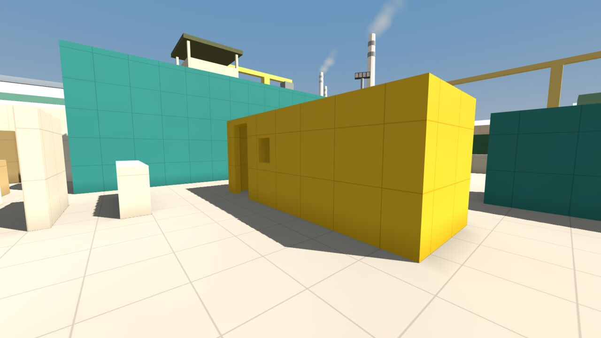

# Airsoft

**Call your hit. Go again.** Airsoft is a first-person, round-based team shooter about a Sunday at an airsoft site:
plastic replicas, BBs you can watch fly, one hit and you're out. Raise your hand, call "HIT!", walk off, reset and go
again. You play single player against bots, as one of two teams, Alpha in blue and Beta in orange.

It is tactical but never grim: replicas kick like toys, BBs puff on what they hit, and where you stand and how you move
decide a fight more than the gear you carry.

## Start here

- **[Getting Started](Getting-Started)**: download, install and your first match.
- **[Controls](Controls)**: every key, and how to change them.
- **[How to Play](How-to-Play)**: hit calling, rounds, the dead zone and the BBs themselves.

## The game

| Playing | Your kit | Matches |
| --- | --- | --- |
| [Movement](Movement): walk, sprint, lean, vault | [Replicas](Replicas): stats for every replica | [Modes](Modes): Elimination, Attack / Defend, Custom |
| [Bots](Bots): difficulties, personalities and kits | [Parts and Power](Parts-and-Power): every part, battery and gas | [Maps](Maps): the fields |
| [Squad Orders](Squad-Orders): tell your teammates what to do | [Loadout](Loadout): saved loadouts and Customise | [Practice Range](Practice-Range) and the timed challenge |
| [HUD and Minimap](HUD-and-Minimap) | [Levels and Unlocks](Levels-and-Unlocks): XP, levels and the Armory | [Settings](Settings) and [Accessibility](Accessibility) |

## News

- **[Patch Notes](Patch-Notes)**: what changed in each version, and what is coming in the next one.
- **[Roadmap](Roadmap)**: what is being built now and what comes after.

## Where the game is today

Airsoft is in early development. <!-- wiki:latest --> Everything on these pages describes the game as it is built
today, and the numbers in the tables are read straight from the game's own files, so they change when the game is
tuned. The game runs on Windows, with a Linux build too. Its look is still greybox: plain shapes and colours, with the
finished models coming later ([Roadmap](Roadmap)).

Found a problem? [Saving and Bug Reports](Saving-and-Bug-Reports#report-a-bug) says how to report it from inside the
game. Building the game yourself? See [Development](Development).
