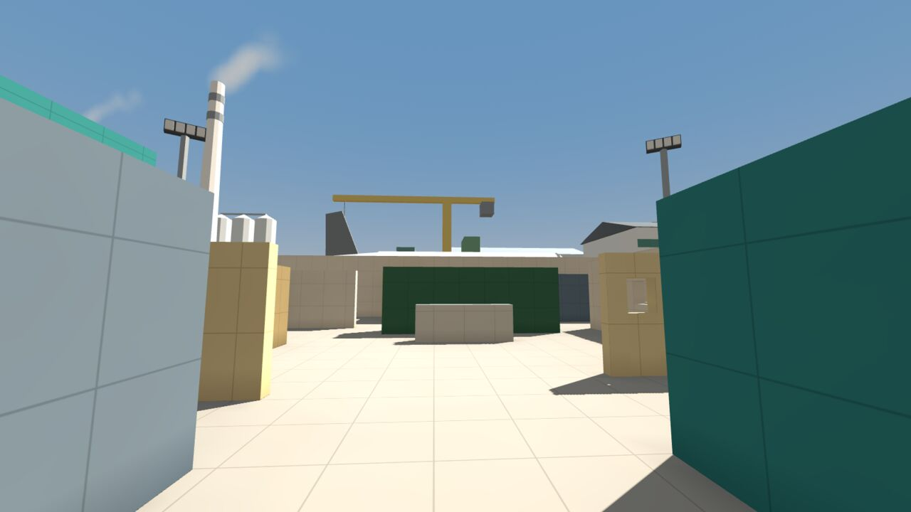
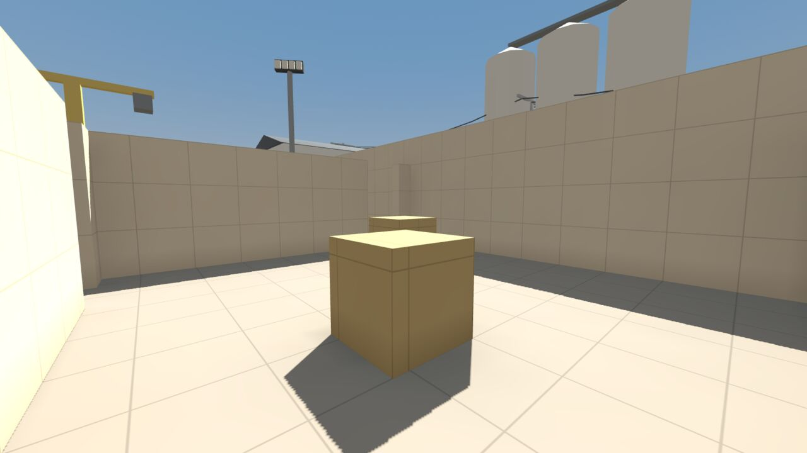

# Maps

Every field in Airsoft is built like a real airsoft site: cover to move between, choke points, flanking routes, long
and short sightlines, and a spawn and a dead zone at each end. Pick a map on the **Match** screen from its picture
card.

<!-- wiki:maps -->

**Team sizes** are the players a side the map offers. [Skirmish](Modes#skirmish-and-custom) plays the usual size;
under Custom rules you pick any size the map offers. Fields are greybox for now: plain blocks and colours, with the
finished models coming later ([Roadmap](Roadmap)).

## Depot

**An abandoned warehouse yard**, played in the sun. Alpha starts at the east end and Beta in the west in
Elimination, and the teams swap ends at half time.

- **The Box** sits in the middle: a roofed shipping container you can fight inside, with offset doors and ports.
- **The Office** has a hall with a low wall you can vault in both directions, and a west room. Gravel beds at its
  doors crunch underfoot.
- **Port walls:** four plywood walls have a port at standing height. Stand to see and shoot through; crouch and you're
  hidden. They can't be vaulted.
- **Noisy props:** run or sprint into a steel skip or a container and it booms, and generators, IBC tanks, racks,
  plastic toilets, wooden crates and wrapped pallets knock too. Players and bots hear it as your footsteps. A BB that
  hits steel hard makes it ring.
- **Attack / Defend** puts a flagpole at the defenders' flag spot ([Modes](Modes#attack--defend)).
- Beyond the walls stand a concrete watch tower to the north, an old aircraft fuselage past the east wall with its fin
  showing, four light masts at the corners, and chimneys, a crane, silos and sheds further out. On Medium graphics and
  up three chimneys smoke, bending with the wind. None of it can be reached.
- Birds, a crow and a dog call from around the yard.

### Areas

The minimap names the area you stand in. Depot's areas:

<!-- wiki:areas depot -->

## Range

**The practice range:** steel plates, figures and moving targets from 5 to 60 m, with no bots and no score. It sits on
the Match screen beside the fields, with Practice as its only mode. Everything about it is on
[Practice Range](Practice-Range).
